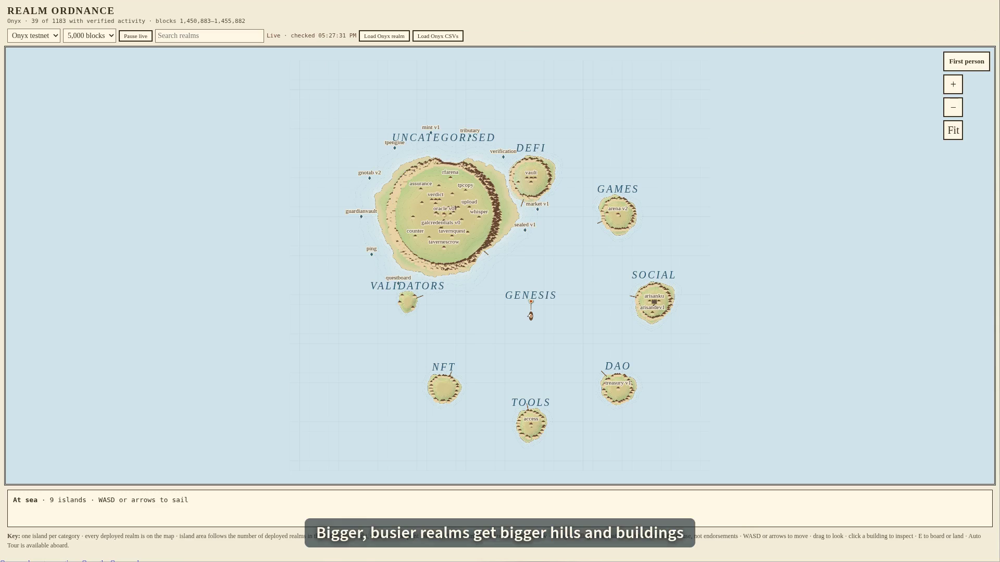
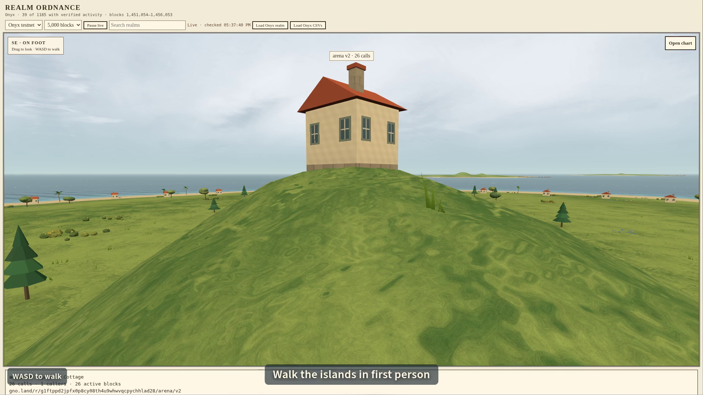
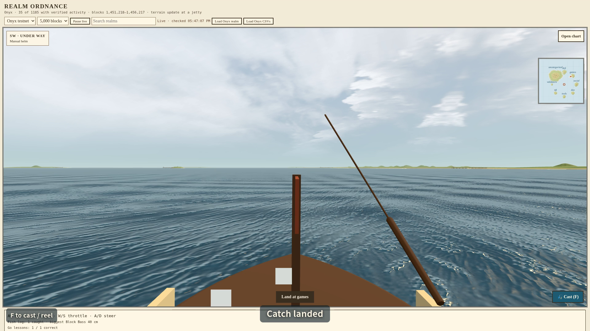

# Realm Ordnance

A walkable, live map of every deployed realm. Islands are categories (defi, games, social, dao, tools, nft, validators, and everything else). Bigger, busier projects get bigger hills and buildings. You can look down on the chart, walk in first person, sail between islands, click a building to open that realm, or fish a short, untimed Go lesson from a jetty or the boat.

## Play

**Public play link:** [https://adhdatom-max.github.io/Realm-Ordnance/](https://adhdatom-max.github.io/Realm-Ordnance/)

That address is GitHub Pages, serving this repository. Enable it once (see [GitHub Pages](#github-pages) below) and the game opens in a browser with no local setup. Live chain queries from this origin were checked against the public RPC endpoints before this was prepared.

**Demo video:** [How to play](video/realm-ordnance-v3.1-how-to-play.mp4) — a short walkthrough of the chart, first person, sailing, fishing, and a Go lesson (under 25 MB).

## On-chain and in the browser

These are separate, and it helps to keep them straight:

**On chain (Onyx realm).** The package `gno.land/r/g19j4y5lzwkcuguf8a95pjueuhn7ay58gm0y3wen/realmordnance` stores an owner-published snapshot of districts and plots. You can read it on the [Onyx realm page](https://onyx.testnets.gno.land/r/g19j4y5lzwkcuguf8a95pjueuhn7ay58gm0y3wen/realmordnance), or in the client with **Load Onyx realm**, which reads the machine-readable `data/districts` and `data/plots` routes through `vm/qrender`. The current published snapshot is **Onyx blocks 1449053-1454052 — 1,178 realms across 8 islands (2026-11-27)**:

| Island | Realms |
| --- | ---: |
| defi | 80 |
| games | 44 |
| social | 52 |
| dao | 29 |
| tools | 25 |
| nft | 24 |
| validators | 4 |
| uncategorised | 920 |

The realm does not run walking, sailing, or fishing. It stores the labelled map. The owner stages a replacement with `Begin`, `AddDistricts`, `AddPlots`, then `Publish`, which swaps the staged map into view atomically. The on-chain source validates field shapes and bounds, but **does not independently verify the supplied activity counts**.

**In the browser.** Opening the page plants every deployed realm from the selected chain's live RPC catalogue (`vm/qpaths`). Usage of each building is checked from RPC in the selected activity window (`block`, `blockchain`, `block_results`, and related queries). That live catalogue can differ slightly from the stored snapshot. Walking, sailing, fishing, and the Go lessons run only in the browser; they are not on-chain transactions. The catch book, rod, and lesson score stay in browser storage.

## Explore

The public play link above is the easiest way in. To run a local copy instead, there is no build step: open `web/index.html` through a short local server.

    python3 -m http.server 8765

Then open [http://127.0.0.1:8765/web/index.html](http://127.0.0.1:8765/web/index.html) in Chrome or Safari. You can also double-click `web/index.html`; if the map stays on empty sea or only the genesis island appears, use the local server. Some browsers restrict network access from `file://`.

The view opens on empty sea with a plain loading status. A tiny genesis island at the centre rises first and shows block 1 of the selected network (height, time, chain ID and block hash) read from that network's RPC. As soon as the realm catalogue returns, every deployed realm is planted and the category islands rise from the water. Choose Mainnet or Onyx to load that chain's full catalogue. The activity window only measures use in recent blocks; changing it does not hide or reveal realms. Each island then independently checks and verifies its own activity numbers from RPC, so a slow island does not block the others. A quiet Games island remains available for its jetty and tackle shop even if no Games realm was called in the window.

- Open the chart for an overhead view and search realm names and paths.
- Switch to first person, use WASD or arrows to walk, and drag to look. Click a building to inspect its realm and follow **Enter realm**. Click the marker on the genesis island to inspect block 1.
- At a jetty, press E or the action button to board or land. W/S controls boat speed and A/D steers. Auto Tour cruises at a slower pace around the islands; manual steering is faster. While you sail in first person, a small chart in the corner shows the boat, its heading and the islands; it hides when you go ashore.
- Find the tackle shop on Games island, take a rod, and cast from a jetty or boat with F or the button. At a bite, answer an **untimed** Go question with one retry to set the hook. Then hold F to reel and release when tension rises. Fishing is a local diversion, not an on-chain transaction.
- Live updates do not teleport someone mid-walk or mid-sail. Changed terrain is applied when you return to a jetty.

Three.js is bundled inside the HTML. The 3D view needs WebGL; live chain scans need internet access. RPC access from a browser also depends on the selected endpoint being reachable and permitting browser requests. If a scan fails, the status line says so and the scan retries; no sample terrain is drawn in its place. If block 1 cannot be read, the genesis island says its details are unavailable.

The browser remembers the last catalogue so a return visit can plant immediately while it refreshes. **Load Onyx CSVs** remains available for files exported from the two snapshot routes. Selecting Onyx in the network menu scans current Onyx activity from RPC; it does not claim to read the stored snapshot.

## The Onyx realm

The Gno source is `realm/ordnance.gno`, package `realmordnance`, at:

`gno.land/r/g19j4y5lzwkcuguf8a95pjueuhn7ay58gm0y3wen/realmordnance`

The package is enabled on Onyx and a snapshot is published, live at [the Onyx realm page](https://onyx.testnets.gno.land/r/g19j4y5lzwkcuguf8a95pjueuhn7ay58gm0y3wen/realmordnance). Package status is also visible through [Onyx package status](https://gpas.onyx.testnets.gno.land/?path=gno.land/r/g19j4y5lzwkcuguf8a95pjueuhn7ay58gm0y3wen/realmordnance). The snapshot listed above was the published chart when this README was updated.

The owner stages a snapshot using these calls, in order:

1. `Begin(cur, label, date)` starts a replacement while the old published map stays visible.
2. `AddDistricts(cur, csv)` stages up to 80 `name,x,z,radius` rows per call.
3. `AddPlots(cur, csv)` stages up to 80 `path,district,name,calls,callers,blocks,x,z,last` rows per call. `x,z` here are offsets from the district centre.
4. `Publish(cur)` validates completion and swaps the staged map into view atomically.

The realm's `Height` uses an integer square-root score relative to its snapshot maximum, while the browser applies a fixed logarithmic height scale to live activity. They convey the same ordering but are not numerically identical. Categories inferred from names may be wrong. Usage shapes how each building looks (height, width, footprint, and cottage / village / castle); these are visual measures of use, not endorsements or a measure of code quality.

## Tests

- `realm/ordnance_test.gno` — `gno test .` in the `realm/` directory. The tests cover staging and the atomic `Publish` swap, settlement thresholds, snapshot data integrity (world coordinates, heights, island counts, and a validators island), and the field-validation helpers used by `Begin`, `AddDistricts`, and `AddPlots`.
- `test/js/` — `node --test test/js/*.test.mjs`. These tests load the categoriser, catalogue parser, snapshot CSV reader, and RPC helpers from `web/index.html` and check path classification, catalogue parsing, and RPC failure handling (HTTP errors, retries, and unreadable ABCI results).

GitHub Actions runs both suites on pushes and pull requests (`.github/workflows/test.yml`). The tests do not change the deployed realm.

## GitHub Pages

If the play link above does not load yet, enable Pages once in this repository:

1. Open **Settings → Pages**.
2. Under **Build and deployment**, set **Source** to **Deploy from a branch**, the branch to **main**, and the folder to **/ (root)**.
3. Click **Save**.

After a minute the game is at [https://adhdatom-max.github.io/Realm-Ordnance/](https://adhdatom-max.github.io/Realm-Ordnance/).

## Source

- `web/index.html` — single-file browser client, catalogue map, per-island activity checks, chart, walk and boat modes.
- `realm/ordnance.gno` and `realm/gnomod.toml` — Onyx realm source and module path.
- `index.html` — short redirect so the Pages root opens the client.

Realm Ordnance is an independent project and is not operated or endorsed by the chain’s organisers.
